# BlockGo System and Blockchain Flow Guide

This file is the repository-level architecture map for coding agents and maintainers. It is based on the current implementation, especially the System Administrator **Settings -> Data Life Cycle** view in `frontend/src/components/system-admin/DataLifeCycle.jsx`.

Use this guide to understand where data originates, which service processes it, where it is stored, when Hyperledger Fabric is involved, and which invariants must be preserved before changing a workflow.

## Authority and documentation precedence

When documentation and code disagree, use this order of authority:

1. Current controller, service, middleware, chaincode, migration, and deployment code.
2. `frontend/src/components/system-admin/DataLifeCycle.jsx` and its tests.
3. This `AGENTS.md` map.
4. `USER_MANUAL.md` and deployment documentation.
5. Older README descriptions and comments.

The root `README.md` contains older wording that can imply Faculty submissions immediately enter Fabric. The current production workflow does **not** do that: active grade workflow records remain in PostgreSQL until Registrar finalization succeeds.

## One-sentence mental model

BlockGo is a role-scoped React application in which PostgreSQL owns operational and approval state, ASP.NET owns academic workflow rules, Node middleware owns cryptographic/Fabric access, Hyperledger Fabric owns finalized grade history, peer CouchDB exposes the latest ledger state, and private IPFS stores encrypted supporting artifacts separately from the grade ledger.

## System context

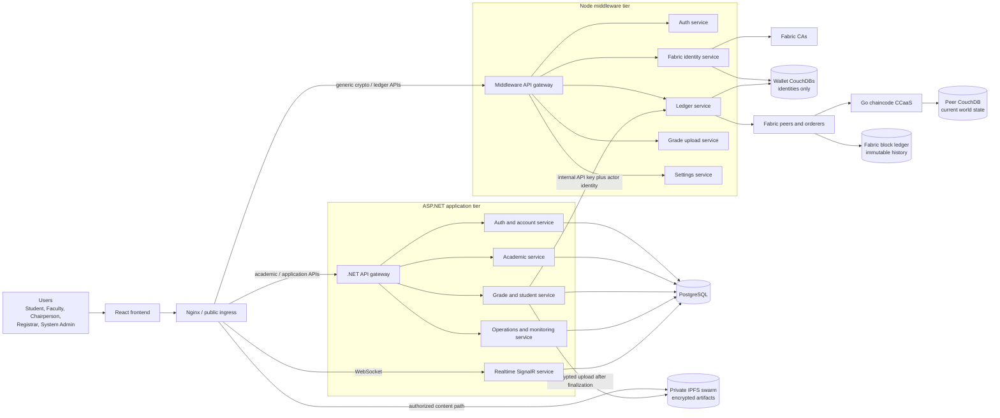

### Current request routing

The public URL remains stable even though both backend tiers are split into services.

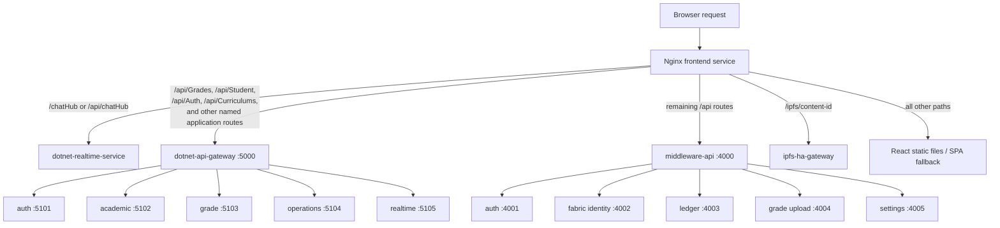

Primary routing sources:

- `network/k8s/12-frontend-nginx-config.yaml`
- `client-app/Microservices/DotnetServiceTopology.cs`
- `middleware/src/shared/route-map.js`
- `frontend/src/services/api.js`

## Role and business flow

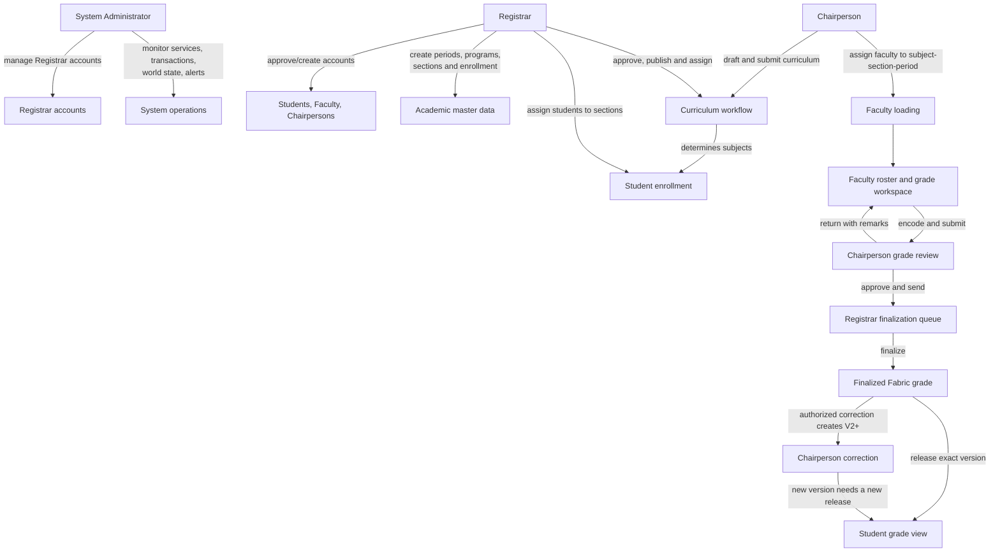

### Role boundaries

| Role | Main operational authority | Fabric behavior |
|---|---|---|
| Student | Own profile, subjects, released grades, own transaction history | Read only; own identity and released records only |
| Faculty | Assigned rosters, draft/returned grades, section submission | Current application workflow stages in PostgreSQL; legacy issue functions still exist but are not the canonical finalization path |
| Chairperson / `department_admin` | Curriculum authoring, faculty loading, department grade review, return/approval/handoff | May read department-scoped history and create an authorized new version of an already-finalized grade |
| Registrar | Accounts, enrollment, sections, periods, curriculum approval, finalization, release | Sole canonical batch finalizer; may read finalized grades but must not directly correct a finalized grade |
| System Administrator | Registrar accounts, support, monitoring, transactions, sanitized world-state browser | Database-only account; read paths can use the protected Registrar service identity fallback; no personal Fabric wallet |

Authorization is enforced more than once:

1. React controls presentation only and is never the security boundary.
2. ASP.NET JWT authorization and record-scope checks protect application workflows.
3. Node middleware introspects the active account, normalizes its role, and resolves the correct Fabric identity.
4. Chaincode verifies MSP, certificate role attributes, actor identity, and academic scope.

## Operational data life cycle

This is the same conceptual flow exposed by System Admin Settings.

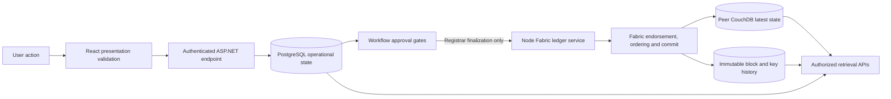

## Canonical grade workflow

### Application workflow state machine

These states belong to `pending_grade_records` in PostgreSQL.

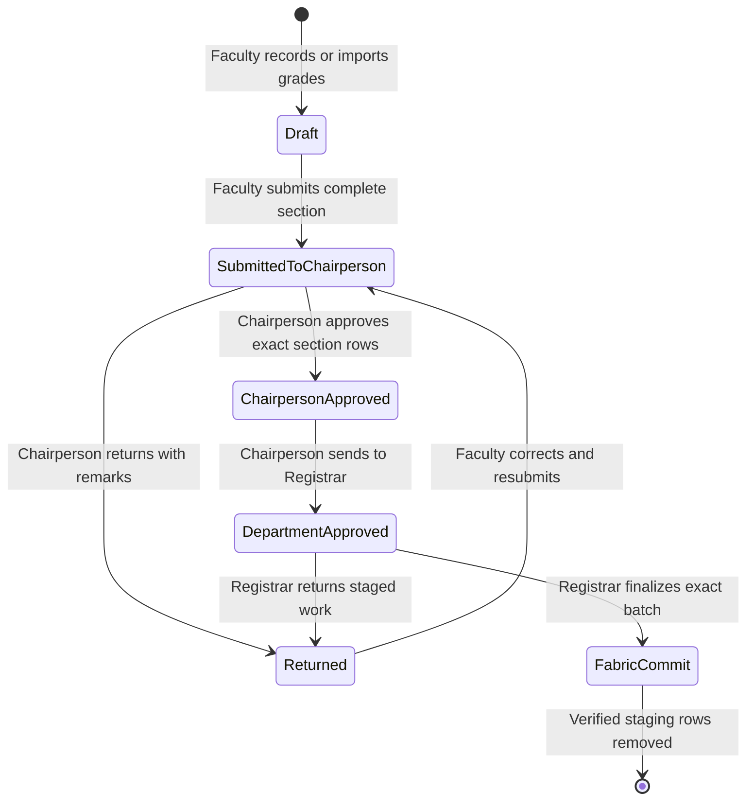

Important identity keys for a grade workload include:

- stable grade record ID;
- `assignment_cycle_id` / Faculty assignment identity;
- academic section ID and canonical section;
- subject code;
- school year;
- semester;
- term (`midterm` or `finals`);
- student identity;
- submitting Faculty identity.

Do not scope a workflow only by a visible section label. Reused section names across periods or programs are not authoritative identity.

### Registrar finalization sequence

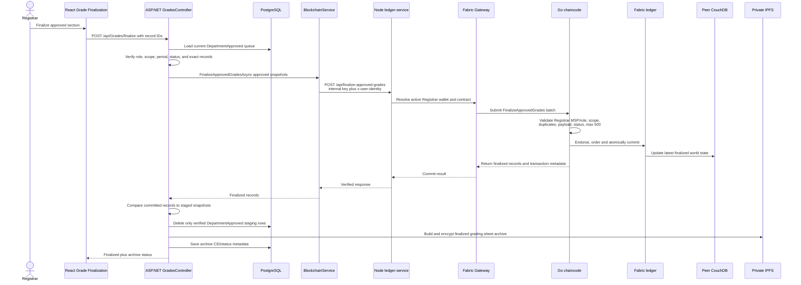

Failure invariants:

- If Fabric finalization fails, approved PostgreSQL staging remains retryable.
- PostgreSQL staging is deleted only after the returned Fabric records match the approved snapshots.
- Finalization is section/batch atomic at chaincode level: validation occurs before writes.
- IPFS archival happens after the Fabric commit. IPFS failure leaves the finalized ledger record authoritative and produces retryable archive metadata.
- Notification failure does not undo a valid finalization.
- Retrying an already-finalized batch is handled idempotently and must not create duplicate versions.

## Fabric grade state and version history

The Go chaincode supports `Issued`, `Returned`, `Corrected`, `DepartmentApproved`, and `Finalized` states. The current application path normally reaches the ledger through `FinalizeApprovedGrades`, which creates or validates the record and commits its finalized state atomically.

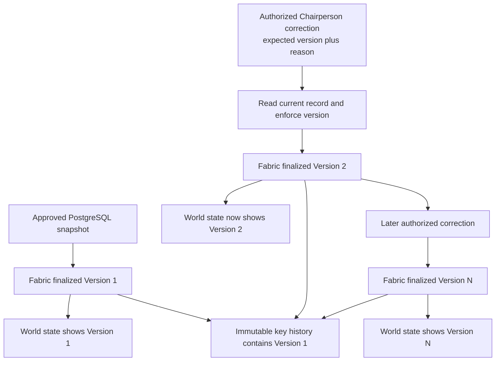

Correction rules:

- `CorrectFinalizedGrade` is limited to the Department MSP / Chairperson role and the record's academic scope.
- The request carries `expected_grade_version`; stale concurrent corrections fail.
- Fabric MVCC prevents two proposals based on the same current version from both committing.
- A successful correction remains `Finalized`, increments the grade version, records the previous transaction, actor, reason, and timestamp, and preserves earlier versions in key history.
- PostgreSQL `gradecorrectionlogs` is a secondary audit copy. The Fabric version is authoritative if that secondary write fails.
- A newly corrected version is not automatically visible to the Student; release is keyed by record ID plus grade version.

Primary chaincode source: `chaincode/main.go`.

## Student retrieval and release gating

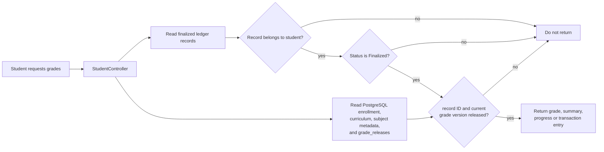

The release key is `recordId|gradeVersion`. Version 1 and Version 2 are separate release decisions. Never replace this with a record-ID-only check.

Key sources:

- `client-app/Controllers/StudentController.cs`
- `client-app/Services/GradeReleasePolicy.cs`
- `client-app/Services/StudentSubjectGradeResolver.cs`
- `client-app/Controllers/GradeController.cs`

## IPFS artifact flow

IPFS is not the grade database and is not the Fabric ledger.

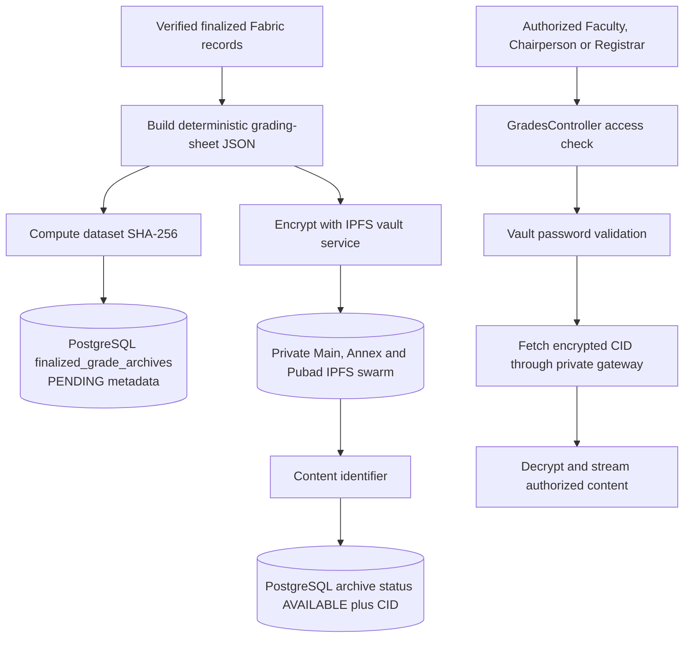

Rules:

- The generated archive includes finalized record IDs, versions, and transaction IDs.
- The dataset hash makes retries idempotent and allows an existing archive to be reused.
- CID/status associations live in PostgreSQL; encrypted bytes live in IPFS.
- Missing `ipfs_cid` or missing archive metadata does not mean the Fabric grade is missing.
- Do not expose the IPFS API or Web UI publicly.
- Never make finalization depend on successful IPFS availability.

Key sources:

- `client-app/Services/FinalizedGradeArchiveService.cs`
- `client-app/Services/IpfsVaultService.cs`
- `client-app/Controllers/GradeController.cs`
- `migrations/028_finalized_grade_archives.sql`

## Storage ownership map

| Data | Authoritative storage | Important implementation |
|---|---|---|
| Accounts, roles, profiles, registration requests | PostgreSQL | `AuthController`, `AccountManagementController`, `users`, profile/request tables |
| Programs, curricula, subjects, active curriculum assignment | PostgreSQL | `CurriculumsController`, curriculum migrations |
| Academic periods, enrollment, sections | PostgreSQL | `AuthController`, `SectioningController`, `academic_periods`, `student_enrollments`, `academicsections` |
| Faculty assignments and schedule | PostgreSQL | `facultysections`, `grade_assignment_cycles` |
| Draft, returned, submitted, approved grades | PostgreSQL | `pending_grade_records` |
| Finalized grade current value | Fabric world state, materialized in peer CouchDB | `FinalizeApprovedGrades`, `ReadGrade`, `GetAllGrades` |
| Every finalized grade version | Fabric block/key history | `GetGradeHistory`, `GetStudentTransactions` |
| Student release decisions | PostgreSQL | versioned `grade_releases` |
| Finalized grading-sheet archive metadata | PostgreSQL | `finalized_grade_archives` |
| Encrypted grading-sheet archive bytes | Private IPFS | `IpfsVaultService`, IPFS HA router |
| Fabric user enrollment material | Fabric CA plus wallet CouchDB | `fabric-identity-service`, wallet manager |
| Support tickets, security events, operational audit rows | PostgreSQL | operations controllers/services |
| Allowed lifecycle audit events | Fabric world state/history in addition to application audit data | `CreateAuditEvent` chaincode transaction |
| Chat messages and conversation state | PostgreSQL; SignalR transports live events | `ChatHub`, chat tables/migrations |
| Browser filters and unsaved form state | React memory/session storage as implemented | frontend components and session services |

### CouchDB distinction

Never use the word "CouchDB" without identifying which kind:

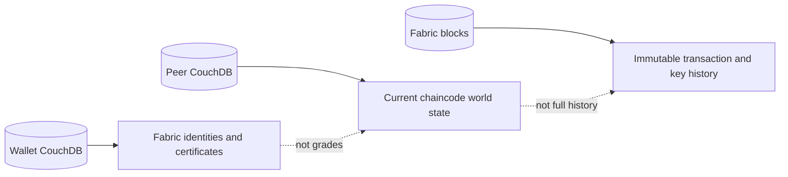

- Wallet CouchDB does not store grades.
- Peer CouchDB stores the latest state used for rich queries.
- Historical versions come from the Fabric ledger/key history, not from old CouchDB documents.

## Fabric transaction boundary

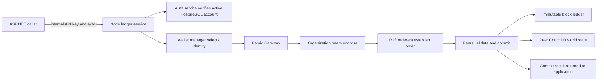

Fabric configuration:

- Channel: `registrar-channel`
- Application organizations: `RegistrarMSP`, `FacultyMSP`, `DepartmentMSP`
- Ordering organization: `OrdererMSP`
- Smart contract: Go chaincode in `chaincode/main.go`, deployed as CCaaS
- Production ordering: six Raft consenters across three zones
- Primary peers: Registrar, Faculty, and Department; secondary peers are optional

Do not bypass `BlockchainService`/`ledger-service` from application controllers. Do not trust a frontend role string as a Fabric identity. Do not change channel, MSP, chaincode, or certificate settings for a UI/workflow-only request.

## Deployment topology

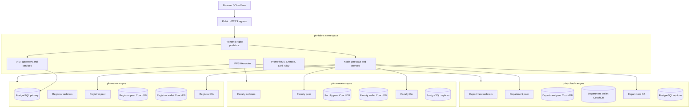

Production persistence and recovery facts:

- PostgreSQL has one writable primary and streaming standbys; promotion is an operator procedure, not automatic application failover.
- Fabric orderers, peers, CAs, CouchDBs, PostgreSQL, and IPFS use persistent volumes.
- Production data services remain private `ClusterIP` services.
- Fabric repair scripts preserve persisted data and use guarded, signature-specific recovery paths.
- Changing the public website hostname does not require regenerating Fabric TLS/MSP material or recreating the channel.

## Source map by workflow

| Concern | Start here | Then inspect |
|---|---|---|
| System Data Life Cycle UI | `frontend/src/components/system-admin/DataLifeCycle.jsx` | `DataLifeCycle.test.jsx`, `SystemAdminPortal.jsx` |
| Frontend API calls | `frontend/src/services/api.js` | calling role component and tests |
| Public request routing | `network/k8s/12-frontend-nginx-config.yaml` | `15-main-ingress.yaml`, middleware route map |
| Authentication and accounts | `middleware/src/services/auth-service.js` | `AuthController.cs`, `AccountManagementController.cs`, auth/session frontend services |
| .NET microservice ownership | `client-app/Microservices/DotnetServiceTopology.cs` | `Program.cs`, `14-client-app.yaml` |
| Curriculum | `client-app/Controllers/CurriculumsController.cs` | curriculum migrations and role components |
| Enrollment and sectioning | `AuthController.cs`, `SectioningController.cs` | enrollment migrations and Registrar/Chairperson components |
| Faculty loading | assignment endpoints in `AuthController.cs` and `BulkUploadController.cs` | `FacultyLoading.jsx`, `AcademicAssignment.jsx`, `FacultyAssignmentRosterService.cs` |
| Grade workflow | `client-app/Controllers/GradeController.cs` | grade services, migrations, Faculty/Chairperson/Registrar components |
| Student grades | `client-app/Controllers/StudentController.cs` | release policy, subject resolver, Student components |
| .NET to Fabric bridge | `client-app/Services/BlockchainService.cs` | `IBlockchainService.cs` |
| Node ledger bridge | `middleware/src/services/ledger-service.js` | gateway manager, wallet manager, auth helpers |
| Ledger rules | `chaincode/main.go` | chaincode tests and Fabric configuration |
| IPFS evidence | `FinalizedGradeArchiveService.cs`, `IpfsVaultService.cs` | archive migration, HA IPFS manifests |
| Monitoring/admin inspection | `SystemMonitoringController.cs` | System Admin frontend components and monitoring manifests |
| Database schema | `network/init-db-schema.sql` | numbered files in `migrations/` |
| Kubernetes/Fabric topology | `network/k8s/README.md` | manifests, `configtx-k8s.yaml`, deployment scripts |

## Invariants future changes must preserve

1. **Operational versus immutable boundary:** drafts and approvals stay in PostgreSQL; Registrar finalization is the canonical Fabric write boundary.
2. **Exact identity:** use stable record, enrollment, academic section, curriculum, and assignment-cycle IDs. Never infer identity from array order or a display label alone.
3. **Layered authorization:** frontend visibility is not authorization. Preserve ASP.NET, middleware, and chaincode checks.
4. **Atomic section workflow:** section approval/finalization validates the complete requested set and avoids partial state transitions.
5. **Verified cleanup:** never delete approved staging before the committed ledger response is checked against the approved snapshot.
6. **Immutable correction history:** finalized records are corrected only by creating a later Fabric version with actor and reason; never overwrite or delete earlier versions.
7. **Versioned release:** Student visibility requires a release for the exact finalized grade version.
8. **IPFS independence:** an archive outage must not invalidate or repeat a successful Fabric transaction.
9. **CouchDB separation:** wallet databases and peer world-state databases are different systems with different data and recovery rules.
10. **System Admin boundary:** the System Administrator is not an academic Fabric actor and does not receive a personal Fabric wallet.
11. **No public data stores:** PostgreSQL, CouchDB, Fabric peer/orderer endpoints, Fabric CAs, and the IPFS admin API stay private.
12. **Backward-compatible public routes:** internal services may change, but stable `/api/*` and `/chatHub` contracts must remain unless the whole dependency chain is migrated.
13. **Current period guard:** grade submission, approval, handoff, and finalization remain tied to the configured academic period and exact assignment.
14. **Registrar cannot directly edit finalized grades:** correction authority stays with the scoped Chairperson flow.
15. **Blockchain is not a replacement for PostgreSQL:** application joins, search metadata, release decisions, accounts, and workflow queues still require relational state.

## Change-analysis checklist for agents

Before changing any workflow represented above:

1. Identify the initiating role and UI component.
2. Trace the frontend API function and exact route.
3. Resolve Nginx/gateway routing to the owning controller or middleware service.
4. Read authorization attributes and record-scope checks.
5. Identify every PostgreSQL table read or written and the applicable migration.
6. Determine whether the operation is operational-only, a Fabric evaluation, or a Fabric submission.
7. If Fabric is involved, trace `BlockchainService`, `ledger-service`, wallet selection, and the exact chaincode function.
8. Check whether the current value comes from peer CouchDB and whether historical values require `GetHistoryForKey`.
9. Check release-version and IPFS archive side effects.
10. Check SignalR notifications and all consuming roles.
11. Search every use of modified routes, status strings, IDs, and DTO fields.
12. Run focused workflow tests, full affected backend/frontend suites, lint/build, and `git diff --check`.

## Quick glossary

- **Operational state:** Mutable application data in PostgreSQL.
- **Staging:** Grade rows in `pending_grade_records` before successful Fabric finalization.
- **Finalization:** Registrar-authorized Fabric commit of an exact approved batch.
- **World state:** Latest chaincode value materialized in peer CouchDB.
- **Ledger history:** Immutable Fabric transactions and prior values for a key.
- **Wallet:** Fabric identity material stored through organization-specific wallet CouchDB; not grade data.
- **MSP:** Fabric organization identity boundary.
- **CCaaS:** Chaincode as a Service; the Go smart contract runs as a separately deployed service.
- **IPFS CID:** Content identifier for encrypted supporting content; not a blockchain transaction ID.
- **Release:** PostgreSQL authorization that makes one exact finalized grade version visible to a Student.
- **Assignment cycle:** Stable Faculty-to-subject-to-section-to-period identity used to prevent ambiguous or stale grade workflows.
